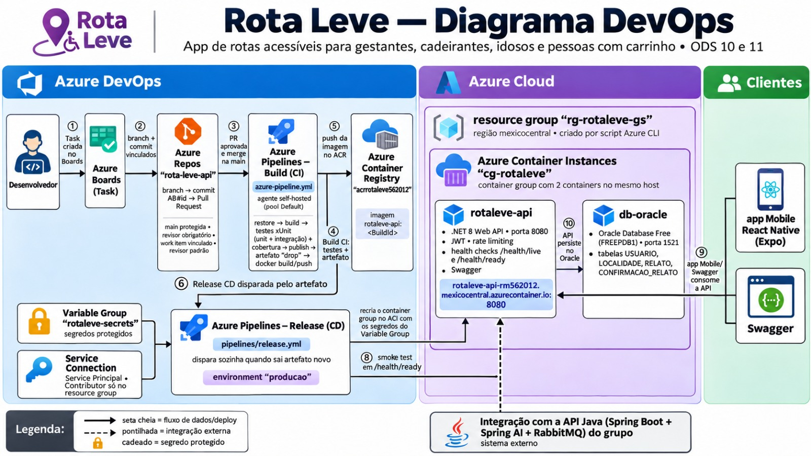

# Rota Leve — API RESTful .NET 8

## Sobre o projeto

O **Rota Leve** é uma API RESTful desenvolvida para a **Global Solution CitizenTech 2026/2**, com foco no registro colaborativo e no acompanhamento de barreiras de acessibilidade urbana.

Esta entrega corresponde ao **backend .NET** do projeto. Cidadãos podem cadastrar relatos sobre localidades, acompanhar ocorrências e confirmar relatos de outras pessoas; administradores podem gerenciar usuários, localidades e a moderação das ocorrências. O cálculo de rotas e os demais clientes do ecossistema não fazem parte desta API.

A implementação utiliza **ASP.NET Core Web API com Controllers**, com:

- arquitetura em camadas, injeção de dependências e padrão Repository;
- persistência relacional em Oracle com Entity Framework Core;
- autenticação JWT e autorização por perfis (`cidadao` e `admin`);
- validações de entrada e códigos de resposta HTTP;
- paginação das listagens e documentação interativa Swagger/OpenAPI;
- idempotência na criação de relatos com `Idempotency-Key`;
- limitação de requisições (*rate limiting*) e resposta HTTP `429`;
- Health Checks, logs com Serilog e tratamento global de erros;
- testes automatizados unitários e de integração com xUnit e Moq.


---

## Índice

1. [Arquitetura](#arquitetura)
2. [Modelo de dados](#modelo-de-dados)
3. [Tecnologias](#tecnologias)
4. [Autenticação e autorização JWT](#autenticação-e-autorização-jwt)
5. [Paginação e validações](#paginação-e-validações)
6. [Idempotência](#idempotência)
7. [Rate limiting](#rate-limiting)
8. [Persistência Oracle e migrations](#persistência-oracle-e-migrations)
9. [Tratamento de erros e códigos HTTP](#tratamento-de-erros-e-códigos-http)
10. [Endpoints](#endpoints)
11. [Swagger e OpenAPI](#swagger-e-openapi)
12. [Monitoramento e logs](#monitoramento-e-logs)
13. [Testes automatizados](#testes-automatizados)
14. [Executando a aplicação localmente](#executando-a-aplicação-localmente)
15. [Docker](#docker)
16. [Segurança e observações para entrega](#segurança-e-observações-para-entrega)
17. [Integrantes](#integrantes)

---

## Arquitetura

O projeto mantém as responsabilidades separadas. A camada HTTP utiliza **ASP.NET Core Web API com Controllers**: endpoints implementados em `Presentation/Controllers`, com `[ApiController]`, atributos HTTP e documentação Swagger.

```text
RotaLeve/
├── RotaLeve.Api/
│   ├── Presentation/
│   │   └── Controllers/
│   ├── Application/
│   │   ├── Dtos/
│   │   └── Services/
│   ├── Domain/
│   │   └── Entities/
│   ├── Infrastructure/
│   │   ├── Data/
│   │   │   └── Migrations/
│   │   └── Security/
│   ├── Properties/
│   ├── appsettings.json
│   ├── Dockerfile
│   └── Program.cs
├── RotaLeve.Tests.Unit/
│   └── Configuration/JwtTestConfiguration.cs
├── RotaLeve.Tests.Integration/
│   └── Configuration/JwtTestConfiguration.cs
├── scripts/
│   └── script-bd.sql
├── RotaLeve.sln
└── README.md
```

**Responsabilidades das camadas:**

- **Presentation:** recebe requisições HTTP, aplica autenticação, autorização, metadados Swagger e traduz resultados dos serviços em respostas HTTP.
- **Application:** implementa casos de uso, DTOs, validações de negócio, paginação e idempotência.
- **Domain:** define as entidades e os conceitos centrais do domínio.
- **Infrastructure:** implementa repositórios, acesso ao Oracle, EF Core, segurança e integração com serviços de infraestrutura.

A API registra os Controllers com `AddControllers()` e `MapControllers()` no `Program.cs`, mantendo as rotas RESTful organizadas por recurso.

---

## Modelo de dados

O backend utiliza um modelo relacional no **Oracle**, composto pelas seguintes entidades:

```text
USUARIO
  ├── 1:N RELATO ──────────────── N:1 LOCALIDADE
  └── 1:N CONFIRMACAO_RELATO ── N:1 RELATO
```

| Entidade | Responsabilidade |
|---|---|
| `USUARIO` | Conta, credenciais protegidas e perfil de acesso |
| `LOCALIDADE` | Local cadastrado onde podem ocorrer problemas de acessibilidade |
| `RELATO` | Ocorrência registrada, situação e referência à localidade e ao autor |
| `CONFIRMACAO_RELATO` | Confirmação comunitária vinculada ao relato e ao usuário |

A localidade não representa necessariamente um problema: ela existe independentemente de possuir relatos. O campo `ATIVO` da localidade controla sua disponibilização nas consultas.

**Regras relevantes:**

- Um cidadão não pode confirmar o próprio relato nem confirmar o mesmo relato duas vezes.
- A primeira confirmação pode alterar o relato de `Novo` para `Ativo`.
- Relatos `Resolvido` ou `Expirado` não aceitam novas confirmações.
- Relatos `Novo`/`Ativo` podem expirar após 72 horas sem nova confirmação, conforme as regras da aplicação.
- O cidadão pode alterar/excluir o próprio relato enquanto estiver `Novo`; o administrador possui permissões adicionais.
- A exclusão de **usuário é física e transacional**, removendo também registros dependentes; a exclusão de **localidade é lógica** (`ATIVO = 0`).

---

## Tecnologias

| Categoria | Tecnologias e recursos |
|---|---|
| Linguagem e runtime | C#, .NET 8 |
| API HTTP | ASP.NET Core Web API com Controllers |
| Banco de dados | Oracle Database |
| Persistência | Entity Framework Core 8 e Oracle.EntityFrameworkCore |
| Segurança | ASP.NET Core Authentication/Authorization, JWT Bearer, hash de senha PBKDF2 |
| Documentação | Swagger UI, OpenAPI, Swashbuckle |
| Resiliência e segurança HTTP | ASP.NET Core Rate Limiting; header `Idempotency-Key` |
| Observabilidade | Serilog, Correlation ID, Health Checks |
| Testes | xUnit, Moq, WebApplicationFactory, testes AAA |

Não há dependência de MongoDB nesta implementação.

---

## Autenticação e autorização JWT

**Cadastro público:**

```http
POST /api/usuarios
Content-Type: application/json
```

Exemplo de corpo:

```json
{
  "nome": "Usuário Exemplo",
  "email": "usuario@example.com",
  "senha": "Senha@123",
  "perfil": "cidadao"
}
```

O perfil padrão é `cidadao`. O cadastro aceita `admin` para **demonstração acadêmica**; em produção, a atribuição do perfil administrativo deve ser restrita.

**Login público:**

```http
POST /api/auth/login
Content-Type: application/json
```

```json
{
  "email": "usuario@example.com",
  "senha": "Senha@123"
}
```

Depois de autenticar, use o valor `accessToken` retornado no cabeçalho:

```http
Authorization: Bearer SEU_TOKEN_JWT
```

A autorização HTTP é implementada por `[Authorize]` e `[AllowAnonymous]`. O perfil `admin` também pode executar as ações destinadas a `cidadao`. Usuários sem JWT válido recebem `401 Unauthorized`; usuários autenticados sem permissão recebem `403 Forbidden`.

### Configuração segura da chave JWT

A aplicação lê a configuração **`Secretkey` diretamente na raiz** da configuração .NET, e não em `Jwt:SecretKey`:

```json
{
  "Secretkey": ""
}
```

**Preencha uma chave JWT forte antes de iniciar a API**, no `RotaLeve.Api/appsettings.json`, em User Secrets ou pela variável de ambiente `Secretkey`. O arquivo distribuído não inclui uma chave real. Se estiver ausente ou vazia, a API interrompe sua inicialização com uma mensagem de configuração, em vez de falhar somente no login.


---

## Paginação e validações

As listagens utilizam paginação no banco de dados, com ordenação e retorno de metadados:

- `GET /api/usuarios` (administrador);
- `GET /api/localidades`;
- `GET /api/relatos`.

| Parâmetro query | Valor padrão | Valores aceitos |
|---|---:|---|
| `pagina` | `1` | De `1` até `1000000` |
| `tamanhoPagina` | `10` | De `1` até `100` |

Exemplo:

```http
GET /api/localidades?pagina=2&tamanhoPagina=5
Authorization: Bearer SEU_TOKEN_JWT
```

Resposta ilustrativa quando há registros (`200 OK`):

```json
{
  "pagina": 2,
  "tamanhoPagina": 5,
  "totalRegistros": 12,
  "totalPaginas": 3,
  "dados": [{ "idLocalidade": 12, "nome": "Praça Central" }]
}
```

Quando a página solicitada não possui registros, a API responde **`204 No Content`**, sem corpo. Parâmetros inválidos retornam `400 Bad Request`.

Os DTOs usam Data Annotations e o comportamento de validação do `[ApiController]`, complementados pelas validações dos serviços. A validação também contempla regras de domínio e valores permitidos para tipos e status.

---

## Idempotência

A criação de relatos exige o cabeçalho **`Idempotency-Key`**:

```http
POST /api/relatos
Authorization: Bearer SEU_TOKEN_JWT
Idempotency-Key: relato-exemplo-001
Content-Type: application/json
```

A implementação calcula:

1. Um SHA-256 do identificador do usuário autenticado combinado com a chave recebida, persistido em `RELATO.CHAVE_IDEMPOTENCIA`.
2. Um SHA-256 do conteúdo normalizado da requisição, persistido em `RELATO.HASH_REQUISICAO`.

O índice único no Oracle impede duplicações concorrentes. O comportamento esperado é:

| Situação | Retorno |
|---|---|
| Primeira criação com a chave | `201 Created` |
| Mesmo usuário, chave e conteúdo | `200 OK` com o relato existente |
| Mesma chave, conteúdo divergente | `409 Conflict` |
| Chave ausente ou inválida | `400 Bad Request` |

A chave é vinculada ao usuário. Esse mecanismo é diferente da regra que impede um cidadão de confirmar o mesmo relato duas vezes.

---

## Rate limiting

A API limita requisições para reduzir abuso e spam:

| Operação | Limite | Critério de agrupamento |
|---|---|---|
| Três listagens `GET` | 5 chamadas por 20 segundos, compartilhadas | IP |
| `POST /api/relatos` | 5 chamadas por 10 minutos | Usuário autenticado; fallback por IP |
| `POST /api/relatos/{id}/confirmacoes` | 20 chamadas por minuto | Usuário autenticado; fallback por IP |

Quando o limite é excedido, a aplicação retorna **`429 Too Many Requests`**.

---

## Persistência Oracle e migrations

A configuração de acesso ao Oracle fica em:

```text
RotaLeve.Api/appsettings.json
ConnectionStrings:OracleDbConnection
```

O modelo fornecido usa o Oracle da FIAP, com usuário e senha **em branco** para preenchimento local. É necessário informar `User Id` e `Password` válidos. Como alternativa, pode-se utilizar a variável de ambiente `ConnectionStrings__OracleDbConnection`.

O Entity Framework Core contém as migrations na pasta `RotaLeve.Api/Infrastructure/Data/Migrations`. A aplicação inicia um serviço de execução de migrations em segundo plano: isso permite abrir o Swagger e consultar `/health/live` enquanto a conexão Oracle é verificada. A criação e o acesso aos dados dependem de o banco estar disponível.

- O serviço de migrations tenta conectar-se novamente em caso de indisponibilidade temporária.
- Em execução com ambiente `Testing`, as migrations automáticas são ignoradas.
- O arquivo `scripts/script-bd.sql` é uma **referência do esquema**, não um script que deve ser executado em paralelo à criação automática por migrations.
- A migration de idempotência acrescenta `CHAVE_IDEMPOTENCIA` e `HASH_REQUISICAO` à tabela `RELATO`.

Para criar uma migration futura, a partir da raiz do projeto:

```bash
dotnet ef migrations add NomeDaMigration --project RotaLeve.Api --startup-project RotaLeve.Api --output-dir Infrastructure/Data/Migrations
```


---

## Tratamento de erros e códigos HTTP

O tratamento centralizado de exceções e as validações de negócio padronizam respostas. Os principais códigos utilizados são:

| HTTP | Significado no projeto |
|---|---|
| `200 OK` | Consulta bem-sucedida, alteração, exclusão ou repetição idempotente |
| `201 Created` | Novo registro criado |
| `204 No Content` | Listagem sem registros na página solicitada |
| `400 Bad Request` | Dados, parâmetros ou chave de idempotência inválidos |
| `401 Unauthorized` | JWT ausente, inválido ou expirado |
| `403 Forbidden` | Usuário sem permissão para a operação |
| `404 Not Found` | Recurso inexistente |
| `409 Conflict` | Conflito de regra de negócio ou chave de idempotência |
| `429 Too Many Requests` | Rate limit excedido |
| `500 Internal Server Error` | Falha interna não tratada |
| `503 Service Unavailable` | Readiness indisponível, incluindo ausência de conexão Oracle |

As operações `DELETE` bem-sucedidas retornam **`200 OK` com JSON de confirmação**. A desativação de localidades é lógica; a exclusão de usuários é definitiva.

---

## Endpoints

As rotas de negócio exigem JWT, exceto onde indicado como **público**.

### Autenticação

| Método | Rota | Permissão | Ação |
|---|---|---|---|
| POST | `/api/auth/login` | Público | Login e emissão do JWT |

### Usuários

| Método | Rota | Permissão | Ação |
|---|---|---|---|
| GET | `/api/usuarios` | Admin | Listar usuários com paginação |
| GET | `/api/usuarios/{id}` | Admin | Consultar usuário |
| POST | `/api/usuarios` | Público | Cadastrar usuário |
| PUT | `/api/usuarios/{id}` | Admin | Atualizar usuário |
| DELETE | `/api/usuarios/{id}` | Admin | Excluir usuário fisicamente e seus vínculos dependentes |

### Localidades

| Método | Rota | Permissão | Ação |
|---|---|---|---|
| GET | `/api/localidades` | Cidadão/Admin | Listar localidades ativas com paginação |
| GET | `/api/localidades/{id}` | Cidadão/Admin | Consultar localidade |
| POST | `/api/localidades` | Admin | Cadastrar localidade |
| PUT | `/api/localidades/{id}` | Admin | Atualizar localidade |
| DELETE | `/api/localidades/{id}` | Admin | Desativar localidade (exclusão lógica) |

### Relatos e confirmações

| Método | Rota | Permissão | Ação |
|---|---|---|---|
| GET | `/api/relatos` | Cidadão/Admin | Listar relatos com paginação |
| GET | `/api/relatos/{id}` | Cidadão/Admin | Consultar relato |
| POST | `/api/relatos` | Cidadão/Admin | Criar relato com idempotência |
| PUT | `/api/relatos/{id}` | Autor elegível/Admin | Atualizar relato |
| DELETE | `/api/relatos/{id}` | Autor elegível/Admin | Excluir relato |
| POST | `/api/relatos/{id}/confirmacoes` | Cidadão/Admin | Confirmar relato de outra pessoa |
| DELETE | `/api/relatos/{id}/confirmacoes/minha` | Cidadão/Admin | Remover a própria confirmação |
| PATCH | `/api/relatos/{id}/status` | Admin | Alterar o status do relato |

### Saúde da aplicação

| Método | Rota | Permissão | Ação |
|---|---|---|---|
| GET | `/health/live` | Público | Verificar se a API está ativa |
| GET | `/health/ready` | Público | Verificar prontidão e conexão Oracle |

**Total: 21 endpoints HTTP**, implementados com Controllers e atributos de roteamento como `[Route]`, `[HttpGet]`, `[HttpPost]`, `[HttpPut]`, `[HttpPatch]` e `[HttpDelete]`.

---

## Swagger e OpenAPI

O Swagger UI oferece documentação interativa e permite executar requisições HTTP e visualizar parâmetros, esquemas e códigos de resposta.

- **Interface:** `http://localhost:5139/swagger` (perfil HTTP local).
- **JSON OpenAPI:** `http://localhost:5139/swagger/v1/swagger.json`.
- **JWT:** clique em **Authorize**, informe o token retornado pelo login e teste os endpoints protegidos.
- **Parâmetros interativos:** `pagina`, `tamanhoPagina` e `Idempotency-Key` aparecem nos endpoints pertinentes.

A documentação é declarada com atributos Swagger/OpenAPI nas actions dos Controllers.

Para um teste rápido: cadastre um usuário, faça login, autorize-se e consulte uma das listagens. O primeiro acesso pode retornar `204` caso o banco não tenha registros naquele recurso.

---

## Monitoramento e logs

A API utiliza **Serilog** para registrar requisições, exceções e diagnósticos em console e em arquivos com rotação diária:

```text
logs/api-YYYYMMDD.log
```

Os logs incluem identificadores de correlação (`X-Correlation-ID` quando enviado, ou um valor gerado) e de rastreamento (`TraceId`). A retenção configurada é de sete arquivos de log.

Health Checks públicos:

- `GET /health/live`: confirma a execução do processo HTTP.
- `GET /health/ready`: verifica também o Oracle; pode responder `503` quando o banco estiver indisponível, mesmo se a interface Swagger estiver acessível.

---

## Testes automatizados

Os projetos `RotaLeve.Tests.Unit` e `RotaLeve.Tests.Integration` utilizam **xUnit**, **Moq** e o padrão **AAA (Arrange, Act, Assert)**. Os testes HTTP utilizam `WebApplicationFactory<Program>` e autenticação de teste para verificar autenticação, autorização, respostas e comportamentos da API.

Há testes para regras de usuários, localidades, relatos, confirmações, emissão e validação de JWT, paginação, limite de requisições e Health Checks. Os testes de integração verificam os contratos HTTP dos Controllers.

**Chave JWT nos testes:** `RotaLeve.Tests.Unit/Configuration/JwtTestConfiguration.cs` e `RotaLeve.Tests.Integration/Configuration/JwtTestConfiguration.cs` leem `Secretkey` da configuração da API e aceita a variável de ambiente correspondente. Na ausência de chave, utiliza um valor fictício exclusivo dos testes; a aplicação real não possui esse fallback.

Para executar a suíte:

```bash
dotnet restore RotaLeve.sln
dotnet build RotaLeve.sln --no-restore
dotnet test RotaLeve.sln --no-build
```

Se houver artefatos antigos do EF Core, faça `dotnet clean RotaLeve.sln`, restaure os pacotes e execute novamente os testes.

---

## Executando a aplicação localmente

### Pré-requisitos

- .NET SDK 8 instalado;
- acesso ao Oracle e usuário com permissões adequadas;
- Visual Studio ou terminal com o comando `dotnet`;
- credenciais Oracle e chave JWT de assinatura, configuradas localmente.

### Configuração inicial

**1. Configure o Oracle** em `RotaLeve.Api/appsettings.json`, preenchendo `User Id` e `Password` em `ConnectionStrings:OracleDbConnection`. Ajuste host, porta e identificador do banco se utilizar outra instância.

**2. Configure a chave JWT** na propriedade raiz `Secretkey`. Sem essa configuração, a aplicação interrompe a inicialização com mensagem explicativa.

**3. Restaure e execute** a partir da pasta que contém `RotaLeve.sln`:

```bash
dotnet restore RotaLeve.sln
dotnet run --project RotaLeve.Api
```

**4. Acesse** `http://localhost:5139/swagger`, utilizando o perfil HTTP local informado em `launchSettings.json`. O banco pode continuar indisponível durante tentativas de migrations em segundo plano, mas operações de persistência exigem Oracle acessível.

**5. Teste o fluxo**: cadastre usuário (`POST /api/usuarios`), autentique (`POST /api/auth/login`), use **Authorize** e execute endpoints com JWT.

### Variáveis de ambiente (alternativa aos arquivos)

```text
Secretkey
ConnectionStrings__OracleDbConnection
```

Não inclua segredos reais no repositório nem em capturas de tela da entrega.

---

## Docker

A pasta `RotaLeve.Api` contém um `Dockerfile` para empacotamento da API. A imagem da aplicação **não substitui o banco Oracle**: a configuração da conexão precisa apontar para uma instância acessível a partir do contêiner.

Exemplo de construção da imagem, a partir da raiz do projeto:

```bash
docker build -f RotaLeve.Api/Dockerfile -t rotaleve-api .
```

Ao executar a imagem, forneça `Secretkey` e `ConnectionStrings__OracleDbConnection` por variáveis de ambiente ou um mecanismo apropriado de segredos; não as grave no Dockerfile. O projeto não pressupõe a existência de pipeline CI/CD ou implantação cloud previamente configurada.

---

## Segurança e observações para entrega

- Nunca publique credenciais reais do Oracle ou a `Secretkey` utilizada em ambiente real.
- O cadastro público de administradores foi mantido **apenas para demonstração acadêmica**; não deve ser exposto dessa maneira em produção.
- O script SQL em `scripts/script-bd.sql` é material de referência; a criação do esquema fica a cargo das migrations da aplicação.
- O projeto contém testes xUnit e não depende de um script PowerShell externo para testar JWT.
- IA generativa foi utilizada como apoio ao desenvolvimento e à revisão do código; os integrantes devem conhecer e compreender a implementação entregue.
- Execute `dotnet build` e `dotnet test` antes do envio final, além de conferir a disponibilidade do Oracle e o comportamento dos endpoints no Swagger.

---

## Integrantes

Preencher os nomes completos e RMs dos integrantes do grupo antes da entrega.

| Nome completo | RM |
|---|---|
Emanuel Italo |  561337
Enzo Monteiro Maciel | 563734
Gabriel Bebé Silva | 562012
Matheus de Almeida Sousa | 563557
Paulo Estalise | 563811
## ☁️ DevOps – CI/CD no Azure DevOps

A API .NET do Rota Leve é publicada automaticamente na Azure a cada merge na `main`, usando **Azure Boards + Azure Repos + Azure Pipelines**. Toda a infraestrutura é criada por **script Azure CLI**.

### Arquitetura macro



**Fluxo:** Task no Azure Boards → branch → commit (`AB#id`) → Pull Request com revisão → merge na `main` → **Pipeline de Build (CI)** → artefato `drop` + imagem no ACR → **Pipeline de Release (CD)** dispara sozinha → container group no ACI (API + Oracle) → smoke test em `/health/ready`.

### Resumo

| Item | Valor |
|---|---|
| Organização / projeto | `Challenge-FIAP-2TDSPO` / `GS-RotaLeve` (privado, Git, Scrum) |
| Repositório | Azure Repos `rota-leve-api` |
| Build (CI) | `azure-pipeline.yml` (raiz) – pipeline `RotaLeve-Build-CI` |
| Release (CD) | `pipelines/release.yml` – pipeline `RotaLeve-Release-CD` |
| Registry | Azure Container Registry `acrrotaleve562012` |
| Execução | Azure Container Instances `cg-rotaleve` (API .NET 8 + Oracle Database Free) |
| Região / RG | `mexicocentral` / `rg-rotaleve-gs` |
| Agente | Self-hosted (pool `Default`) |
| URL | `http://rotaleve-api-rm562012.mexicocentral.azurecontainer.io:8080/swagger` |

### Estrutura de DevOps no repositório

```
azure-pipeline.yml              # Pipeline de Build (CI)
pipelines/release.yml           # Pipeline de Release (CD)
dockerfiles/Dockerfile          # Imagem multi-stage da API
.dockerignore
scripts/infra-azure-cli.sh      # Provisionamento (RG, ACR, Service Principal)
scripts/setup-azure-devops.sh   # Projeto, Repos, políticas da main e pipelines
scripts/script-bd.sql           # DDL Oracle
```

### Pipeline de Build (CI)

Dispara a cada commit na `main` (que só recebe código via PR). Alterações apenas em `README.md` e `docs/` não disparam o build.

| Etapa | O que faz |
|---|---|
| Instalar .NET 8 SDK | `UseDotNet@2` |
| Restore / Build | `dotnet restore` e `dotnet build -c Release` |
| Testes automatizados | xUnit (unitários + integração); resultados na aba **Tests** |
| Cobertura | `XPlat Code Coverage` publicada na aba **Code Coverage** |
| Publish | `dotnet publish` da API em `.zip` |
| Artefato | `PublishPipelineArtifact` → artefato **`drop`** |
| Imagem Docker | build e push no ACR com tags `$(Build.BuildId)` e `latest` |

### Pipeline de Release (CD)

Dispara automaticamente quando o Build termina com um novo artefato (`resources.pipelines`), usando o environment `producao`.

| Etapa | O que faz |
|---|---|
| Download | Baixa o artefato `drop` do build de origem (rastreabilidade) |
| Recriar container group | Gera o manifesto do ACI e recria o container group com a imagem `rotaleve-api:<BuildId>` + Oracle Free |
| Smoke test | Até 40 tentativas em `/health/ready` (API + conexão Oracle) |

### Variáveis e segredos

Nenhuma senha fica no código. Os valores ficam no **Variable Group `rotaleve-secrets`** (marcados como secret) e chegam aos scripts apenas via `env:`; no ACI são `secureValue`.

| Variável | Uso |
|---|---|
| `ORACLE_ROOT_PASSWORD` | Senha administrativa do Oracle no container |
| `ORACLE_APP_USER` | Usuário/schema da aplicação |
| `ORACLE_APP_PASSWORD` | Senha do usuário da aplicação |
| `JWT_SECRET` | Chave de assinatura do JWT (`Secretkey`) |

**Service connections:** `sc-azure-rotaleve` (Azure Resource Manager, Service Principal com *Contributor* restrito ao resource group – menor privilégio) e `sc-acr-rotaleve` (Docker Registry).

### Branch principal protegida

- Mínimo de 1 revisor (o autor pode aprovar a própria PR – simulação)
- Work item vinculado obrigatório
- Revisor padrão: RM562012

### Como reproduzir

```bash
# 1. Infraestrutura (Git Bash: export MSYS_NO_PATHCONV=1)
export SUBSCRIPTION_ID="<id-da-assinatura>" RM="<rm>"
./scripts/infra-azure-cli.sh --sp        # RG + ACR + Service Principal

# 2. Azure DevOps (az extension add --name azure-devops ; az devops login)
export ORG_URL="https://dev.azure.com/<org>" REVIEWER_EMAIL="<email>"
./scripts/setup-azure-devops.sh          # projeto, repo, políticas e pipelines

# 3. No portal: Variable Group rotaleve-secrets, service connections e environment producao

# 4. Merge de uma PR na main → Build → Release

# Encerrar custos (mantém ACR e RG)
./scripts/infra-azure-cli.sh --destroy
```

### Evidência de persistência (SELECT no banco)

```bash
az container exec -g rg-rotaleve-gs -n cg-rotaleve --container-name db-oracle --exec-command "sqlplus / as sysdba"
```
```sql
ALTER SESSION SET CONTAINER = FREEPDB1;
ALTER SESSION SET CURRENT_SCHEMA = RM562012;
SELECT ID_LOCALIDADE, NOME, TIPO, ENDERECO, ATIVO FROM LOCALIDADE ORDER BY ID_LOCALIDADE;
SELECT ID_RELATO, ID_LOCALIDADE, TIPO, DESCRICAO, STATUS FROM RELATO ORDER BY ID_RELATO;
```


## 🤖 Declaração de uso de IA generativa

| Ferramenta | Para quê |
|---|---|
| Claude (Anthropic) | Apoio na escrita dos scripts Azure CLI, pipelines YAML, diagnóstico de erros de build/deploy e revisão desta documentação |

Todo o conteúdo gerado foi revisado, executado e validado pelo grupo antes do commit.
